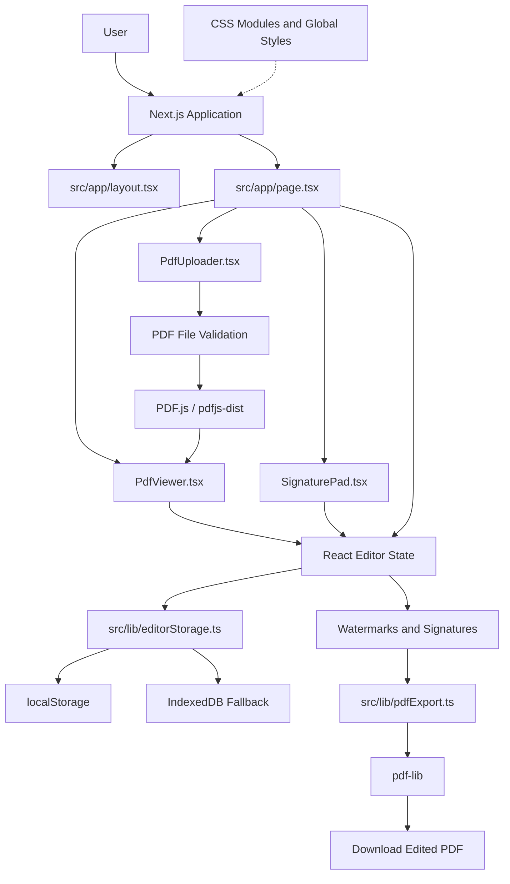

# DocuCraft — Application Architecture

## 1. Overview

DocuCraft is a browser-based PDF Watermarking and E-Sign Editor built with Next.js, React, and TypeScript.

The application follows a component-based architecture. The main editor page coordinates the user interface, PDF components handle document upload and viewing, the signature component manages signature input, and separate library modules handle PDF export and editor-state persistence.

PDF processing and browser-based editor recovery take place on the client side. The application does not require a backend server for its described editing and export workflow.

## 2. Component Structure

The main source files and their responsibilities are:

- **`src/app/page.tsx`** — Main editor page. Coordinates editor state, editing modes, PDF loading, state restoration, autosave, and export actions.
- **`src/app/layout.tsx`** — Defines the root layout of the Next.js application.
- **`src/components/pdf/PdfUploader.tsx`** — Handles PDF selection, drag-and-drop input, and upload-related validation.
- **`src/components/pdf/PdfViewer.tsx`** — Loads and displays PDF pages and coordinates document loading with the parent editor.
- **`src/components/signature/SignaturePad.tsx`** — Provides the interface for drawing, clearing, and using a signature, as well as supported signature image input.
- **`src/lib/pdfExport.ts`** — Contains PDF export logic using `pdf-lib`.
- **`src/lib/editorStorage.ts`** — Provides browser storage helpers for saving and restoring supported editor-state data, including fallback handling between browser storage methods.
- **CSS Modules and global styles** — Define component-specific styles and the overall application appearance.

This structure separates the interface, PDF rendering, signature input, export processing, and editor-state persistence.

## 3. Application Architecture Diagram

The following diagram shows the main relationships between the editor components, PDF libraries, browser storage, and export functionality.

## 4. State Management

DocuCraft uses React state to manage interactive editor data and user-interface changes.

The state coordinates information such as the selected document, current editing mode, watermarks, signatures, selected editing elements, page-specific changes, and relevant editor settings.

Components communicate through props and callback functions where required. When a user adds, selects, moves, resizes, rotates, edits, or deletes an element, React state updates the interface.

The main editor page coordinates state restoration and autosave. Autosave must not run before the initial restoration process has completed, because saving an initial empty state could overwrite previously saved editor data.

## 5. PDF Loading and Rendering

DocuCraft uses PDF.js through `pdfjs-dist` to load and render PDF documents.

The PDF loading workflow is:

1. The user selects or drops a PDF file.
2. `PdfUploader.tsx` handles the file input and applicable validation.
3. The main editor coordinates loading of the selected document.
4. PDF.js loads the document and makes its pages available.
5. `PdfViewer.tsx` renders the current page for the editor.
6. The editor becomes ready for editing after the applicable loading and restoration steps are handled.

PDF rendering is separated from editing controls. Rendering and file-loading errors are handled so that invalid or unreadable documents are not silently treated as successfully loaded.

## 6. Watermark Implementation

DocuCraft supports text and image watermarks.

Users can add multiple watermarks and perform supported editing operations, including moving, resizing, rotating, modifying, and deleting elements.

Watermark data is maintained in the editor state. The interface displays the elements over the PDF preview, while the export module applies supported watermark data to the final PDF.

Watermark editing and PDF export are separate responsibilities: the preview represents the current editing state, and the export module generates the downloadable document.

## 7. E-Sign Implementation

DocuCraft provides E-Sign mode alongside Watermark mode.

`SignaturePad.tsx` supports drawing a signature on a canvas, clearing the canvas, using the completed signature, and selecting supported signature images.

After a signature is added, the editor manages its placement and supported transformations. Signatures can be assigned to different PDF pages and included in the exported document.

The feature provides visual signature placement. It does not, by itself, create a cryptographic digital signature or independently verify the signer's identity.

## 8. PDF Export

PDF export is implemented in `src/lib/pdfExport.ts` using `pdf-lib`.

The export process takes the source PDF and applies supported watermark and signature elements to the appropriate pages. The implementation accounts for the relationship between PDF preview coordinates and PDF page coordinates.

The resulting document is generated as a downloadable PDF. Export logic is separated from the main user interface to make PDF processing easier to maintain and test.

## 9. Editor-State Persistence and Recovery

The editor uses `src/lib/editorStorage.ts` to manage browser-based persistence of supported editor-state data.

The storage workflow is:

1. The editor creates or updates supported editing data.
2. The main editor saves eligible state through the storage helper.
3. `localStorage` is used where possible.
4. If saving to `localStorage` fails, the application attempts to use IndexedDB as a fallback.
5. When the same original PDF is uploaded again, the application checks for matching saved editor data.
6. Saved data is validated before restoration.
7. Autosave becomes eligible after the restoration process has completed.

The implementation also handles malformed saved data and storage failures. If both storage methods fail, the application can display a warning rather than silently treating the save as successful.

### Persistence Limitations

- The original PDF file is not stored by the editor-state recovery feature.
- Users may need to upload the same original PDF again after refreshing the page.
- Recovery depends on saved data remaining available and matching the uploaded document.
- Clearing the site's browser data may remove saved changes.
- Browser storage is not permanent server-side storage or cloud synchronization.

## 10. File Handling

PDF files and supported watermark or signature images are handled through browser file input and the editor components.

The application validates supported inputs where applicable and reports errors when files cannot be read, decoded, loaded, or processed.

The original PDF is used for viewing and export. Supported editor elements are maintained separately and applied during PDF export. The final edited PDF is generated for the user to download locally.

## 11. Error Handling

DocuCraft includes error handling for common document and editing failures, including:

- Invalid or corrupted PDF files.
- PDF loading or page-rendering failures.
- Unavailable canvas functionality.
- Invalid or unreadable watermark and signature images.
- Unsupported content during PDF export.
- Malformed saved editor data.
- Browser storage quota or persistence failures.

These checks help prevent failed operations from being treated as successful and provide feedback when an operation cannot be completed.

## 12. Testing and Maintainability

The project uses Playwright for browser-based end-to-end tests and unit tests for PDF export functionality.

Tests cover key editor workflows and selected edge cases, including PDF upload, watermark and signature operations, export, saved-state validation, and browser storage failure handling.

The project also uses NYC to collect code coverage for the files configured in `.nycrc.json`. Coverage results apply only to the configured source files and do not guarantee the absence of defects.

The component-based structure and separate storage and export modules help keep responsibilities understandable, testable, and maintainable.
