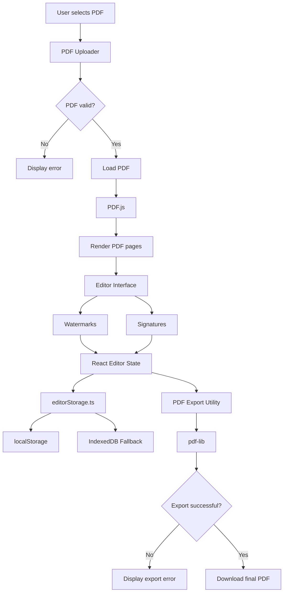

# DocuCraft — Data Flow Documentation

## 1. Purpose

This document explains how data moves through DocuCraft, from selecting a PDF file to editing it with watermarks or signatures and exporting the final document.

DocuCraft is a browser-based PDF editor built with Next.js, React, and TypeScript.

## 2. High-Level Data Flow

The main workflow is:

1. The user selects or drops a PDF file.
2. The application validates and reads the selected file.
3. PDF.js loads and renders the PDF pages for preview.
4. The user adds or edits watermarks and signatures.
5. React state maintains the current editing information.
6. The application saves supported editor data using browser storage.
7. The user requests PDF export.
8. The export utility generates the edited PDF.
9. The browser downloads the final document.

## 3. Data-Flow Diagram



## 4. PDF Upload and Validation

**Relevant file:** `src/components/pdf/PdfUploader.tsx`

The user selects a PDF through the upload interface or drops a file into the supported drop area.

The application checks whether the selected file can be processed. Invalid file types, empty files, and unreadable PDFs are handled through the application's error-handling workflow.

After validation, the PDF data is passed to the loading workflow. The original PDF is used for preview and export.

## 5. PDF Rendering

**Relevant file:** `src/components/pdf/PdfViewer.tsx`

DocuCraft uses PDF.js through `pdfjs-dist` to load and render PDF pages in the browser.

PDF pages are displayed using canvas elements.

The responsibilities are separated:

- **PDF.js:** Loads and renders PDF pages for preview.
- **React editor:** Manages interactive editing controls and elements.
- **pdf-lib:** Processes the document during export.

The preview canvas is not itself the final exported PDF. The export utility processes the source PDF and supported editing data.

## 6. Watermark Data Flow

DocuCraft supports text and image watermarks.

Users can add multiple watermarks and modify their supported properties, including:

- Watermark type and content.
- Position on the PDF page.
- Width and height.
- Rotation and opacity.
- Text color and other supported appearance settings.

The editor maintains watermark information for preview and editing. Changes update the editor state and are used by the export workflow.

**Relevant files:**

- `src/app/page.tsx`
- `src/components/pdf/PdfViewer.tsx`
- `src/lib/pdfExport.ts`

## 7. E-Sign Data Flow

DocuCraft provides a visual E-Sign mode for adding signatures to PDF pages.

Supported signature input methods include:

1. Text signatures.
2. Drawn signatures.
3. Uploaded signature images.

**Relevant file:** `src/components/signature/SignaturePad.tsx`

Drawn signatures are created using a canvas-based interface. Uploaded signature images are validated and prepared before use.

Users can position and resize supported signature elements. During export, the PDF export utility embeds the signatures into their corresponding pages.

This is a visual signature feature. It does not, by itself, provide cryptographic digital-signature verification or certificate-based signing.

## 8. Editing State and Transformations

The editor coordinates the source PDF, watermarks, signatures, and their editing properties.

Supported operations can include moving, resizing, rotating, changing, and deleting elements.

React state maintains the editing information used by the preview and export workflows. The exported document is generated from the source PDF and editing data rather than simply exporting a screenshot of the preview.

The editor also includes undo/redo and browser-based editor-state restoration features.

## 9. Coordinate Conversion and PDF Export

**Relevant file:** `src/lib/pdfExport.ts`

The editor preview and the PDF document can use different coordinate systems. Element positions may therefore need to be converted before being drawn into the PDF.

The export implementation handles relevant positioning and transformation details, including page dimensions, element placement, dimensions, rotation, and page rotation where supported.

The `pdf-lib` library loads the source PDF and embeds supported text and image elements.

## 10. Download Flow

When the user selects **Export PDF**, the workflow is:

1. The application collects the source PDF and relevant editing data.
2. The export utility processes the PDF and supported editing elements.
3. Export errors are handled if the operation fails.
4. If export succeeds, the browser downloads the generated PDF.

The downloaded PDF is the final output of the editing workflow.

## 11. Error Handling

DocuCraft handles common document, file-processing, and export problems.

Examples include:

- Invalid or malformed PDF files.
- Unsupported file types and empty files.
- PDF loading or rendering failures.
- Invalid or unreadable image inputs.
- Signature image preparation failures.
- Text that cannot be exported using the configured PDF font.
- Errors while generating the final PDF.
- Browser-storage failures.

The application should not treat a failed operation as a successful export or save. Appropriate feedback helps users understand when an operation cannot be completed.

## 12. Browser Storage and Restoration

**Relevant file:** `src/lib/editorStorage.ts`

DocuCraft saves supported editor data in browser storage so that editing changes can be restored.

The storage workflow is:

1. React state contains the current editor information.
2. The storage module attempts to save the supported data.
3. `localStorage` is used where possible.
4. If the primary storage write fails, the application can use IndexedDB as a fallback.
5. When the user refreshes and uploads the same original PDF again, the application attempts to match the saved editor state and restore supported changes.

Saved information can include supported page-specific edits, settings, watermarks, and signatures.

The application validates saved data before applying it. If both storage mechanisms fail, it reports the storage problem rather than claiming that the data was saved successfully.

**Important limitations:**

- The original PDF file itself is not saved for automatic reopening.
- The user may need to upload the same PDF again after refreshing.
- Saved editor data can be lost if browser storage is cleared.
- Browser storage does not synchronize data across different browsers or devices.
- Browser storage is not a substitute for server-side storage or cloud backup.

A saved editor state is different from a downloaded, exported PDF.

## 13. Automated Test Coverage

The project uses Playwright for browser-based end-to-end testing and separate unit tests for PDF export functionality.

The tests cover PDF upload, watermark editing, signature workflows, export behavior, storage restoration, and error handling.

The latest reported test run completed:

- **123 Playwright tests passed.**
- **15 PDF export unit tests passed.**
- **Total: 138 tests passed.**

The reported code coverage was:

- Statements: 93.85%
- Branches: 90.37%
- Functions: 96.61%
- Lines: 93.92%

These figures apply to the configured coverage scope and do not necessarily represent every file in the repository.

Run the complete test and coverage workflow using:

```bash
npm run test:e2e:coverage
```

## 14. Summary

DocuCraft's data flow starts with PDF selection and validation, continues through PDF.js rendering and interactive editing, and ends with PDF generation and browser download.

React manages the editor interface, `editorStorage.ts` handles supported browser-based persistence, PDF.js provides the document preview, and `pdf-lib` generates the exported PDF with supported watermarks and signatures.

Separating upload, rendering, editing, storage, export, and testing responsibilities makes the application easier to maintain, test, and explain.
