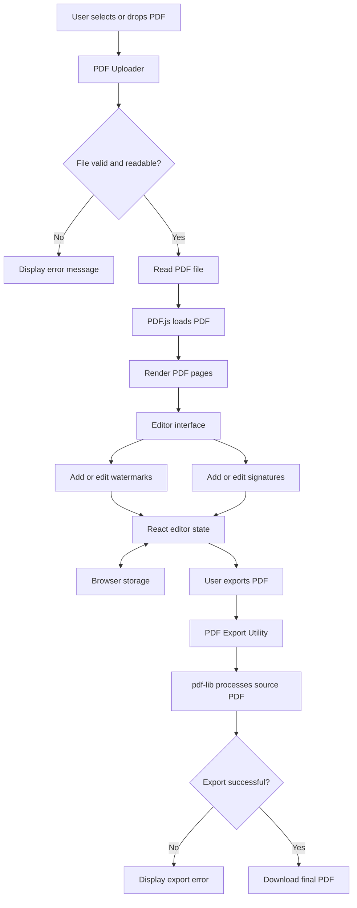

# DocuCraft — Data Flow Documentation

## 1. Purpose

This document explains how data moves through DocuCraft, from selecting a PDF file to editing it with watermarks or signatures and exporting the final document.

DocuCraft is a browser-based PDF editor built with Next.js, React, and TypeScript.

## 2. High-Level Data Flow

The main workflow is:

1. The user selects or drops a PDF file.
2. The application validates and reads the selected file.
3. PDF.js loads and renders the PDF pages for preview.
4. The user adds or edits watermarks and signatures.
5. The editor maintains the data and properties required for editing.
6. The user requests PDF export.
7. The export utility embeds supported editing elements into the PDF.
8. The browser downloads the generated PDF.

## 3. Data-Flow Diagram

## 4. PDF Upload and Validation

**Relevant file:** `src/components/pdf/PdfUploader.tsx`

### File Selection

The user selects a PDF through the upload interface or drops a file into the supported drop area.

### Validation

The application checks whether the selected file can be accepted and processed. Invalid or unreadable documents are handled through the application's error-handling workflow.

The automated tests cover file-handling scenarios such as invalid file types, empty files, and problematic PDF inputs.

### Reading the File

After the file passes the relevant checks, its data is passed to the PDF loading workflow. The original PDF serves as the source document for preview and export.

## 5. PDF Rendering

**Relevant file:** `src/components/pdf/PdfViewer.tsx`

DocuCraft uses PDF.js through the `pdfjs-dist` library to load and render PDF pages in the browser.

The viewer renders PDF pages using canvas elements, allowing users to preview the document while editing.

The rendering and export responsibilities are separate:

- **PDF.js:** Loads and renders PDF pages for preview.
- **React editor:** Displays editing controls and interactive watermark and signature elements.
- **pdf-lib:** Processes the PDF during export.

The preview canvas is not itself the final exported PDF. The export utility works with the source PDF and the relevant editing data to generate the final document.

## 6. Watermark Data Flow

DocuCraft supports text and image watermarks.

Users can add multiple watermarks and use the available editing controls to modify their content, appearance, and placement.

Watermark properties may include:

- Watermark type: text or image.
- Text content or image data.
- Position on the PDF page.
- Width and height.
- Rotation.
- Opacity.
- Text color and other supported appearance settings.

The editor maintains watermark information for preview and editing. When a watermark is modified, the updated properties are used by the viewer and the export workflow.

During export, the PDF export utility uses the applicable watermark data to place the watermark on its assigned PDF page.

**Relevant files:**

- `src/app/page.tsx`
- `src/components/pdf/PdfViewer.tsx`
- `src/lib/pdfExport.ts`

## 7. E-Sign Data Flow

DocuCraft provides an E-Sign mode for adding visual signatures to PDF pages.

The supported signature input methods include:

1. Text signatures.
2. Drawn signatures.
3. Uploaded signature images.

**Relevant file:** `src/components/signature/SignaturePad.tsx`

### Text Signature

The user enters signature text, which is used by the editor to create a visual signature element.

### Drawn Signature

The user draws a signature using the canvas-based signature interface. The resulting signature image can be used in the editor.

### Uploaded Signature Image

The user can upload a supported PNG or JPEG signature image. The application validates and processes the image before it is used as a signature element.

### Editing and Export

The user can position and resize signature elements using the available editor controls. Signatures can be placed on different PDF pages.

During export, the PDF export utility embeds the supported signature elements into their corresponding pages.

This is a visual signature feature. It does not, by itself, provide cryptographic digital-signature verification or certificate-based signing.

## 8. Editing State and Element Transformations

The editor coordinates the PDF document, watermark elements, signature elements, and their editing properties.

Depending on the selected element and the available controls, properties can include position, dimensions, rotation, content, and appearance.

Operations such as moving, resizing, rotating, modifying, and deleting elements update the editing data used by the preview and export workflows.

The export process uses the editing data rather than simply exporting a screenshot of the preview. This allows the generated PDF to contain actual watermark and signature elements.

The editor also includes undo/redo and browser-based editor-state restoration features.

## 9. Coordinate Conversion and PDF Export

**Relevant file:** `src/lib/pdfExport.ts`

The editor preview and the PDF document can use different coordinate systems. Therefore, element positions in the preview may need to be converted before they are drawn into the PDF.

The export implementation handles relevant positioning and transformation details, including page dimensions, element placement, dimensions, rotation, and page rotation where supported.

DocuCraft uses `pdf-lib` to load the source PDF and embed supported text and image elements.

The export workflow aims to preserve the final editing positions and page assignments in the generated document. Automated tests cover selected PDF export scenarios, including different page dimensions, rotations, watermarks, and signatures.

## 10. Download Flow

When the user selects **Export PDF**, the workflow is:

1. The application collects the source PDF and relevant editing data.
2. The export utility processes the document and supported editing elements.
3. The application handles any export errors.
4. If export succeeds, the generated PDF is offered as a browser download.

The downloaded PDF is the final output of the editing workflow.

## 11. Error Handling

DocuCraft includes error handling for common document, file-processing, and export problems.

Examples covered by the implementation or automated tests include:

- Invalid or malformed PDF files.
- Unsupported file types.
- Empty files.
- PDF loading or rendering failures.
- Invalid or unreadable image inputs.
- Signature image preparation failures.
- Text that cannot be exported using the configured PDF font.
- Errors while preparing the final PDF.

The application handles failures so that unsuccessful operations are not treated as successful exports. Appropriate feedback helps users understand when an operation cannot be completed.

## 12. Browser Storage and Restoration

DocuCraft includes browser-based restoration of saved editor state.

Automated tests cover restoring saved page-specific edits when the same PDF is uploaded again, handling malformed saved data, and refreshing during editing.

Browser-based editor-state restoration is different from permanent server-side storage. The application can restore supported editing information from browser storage, while the generated PDF is downloaded to the user's local system.

A saved editor state is not the same as a saved, exported PDF.

## 13. Automated Test Coverage

The project includes Playwright end-to-end tests and unit tests for PDF export functionality.

| Test file | Main responsibility |
|---|---|
| `tests/pdf-upload.spec.ts` | PDF upload and file-handling scenarios |
| `tests/watermark.spec.ts` | Watermark creation, editing, and export |
| `tests/signature.spec.ts` | Signature creation, editing, and export |
| `tests/edge-cases.spec.ts` | Boundary conditions and unusual inputs |
| `tests/editor-bonus.spec.ts` | Additional editor features and workflows |
| `tests/pdfExport.unit.mjs` | Unit tests for PDF export logic |
| `tests/homepage.spec.ts` | Initial application interface |

The Playwright tests verify browser-level behaviour, while the PDF export unit tests validate selected export scenarios.

The reported successful test run completed **112 Playwright tests and 11 PDF export unit tests**. The reported coverage was:

- Statements: 92.94%
- Branches: 86.40%
- Functions: 96.58%
- Lines: 93.00%

These figures apply to the configured coverage scope and do not necessarily represent every file in the repository.

## 14. Summary

DocuCraft's data flow begins with PDF selection and validation, continues through PDF.js rendering and interactive editing, and ends with PDF generation and browser download.

React manages the interactive editor interface, PDF.js provides the document preview, and `pdf-lib` is used to embed supported watermarks and signatures into the exported PDF.

Separating upload, rendering, editing, export, and testing responsibilities makes the workflow easier to maintain, test, and explain.
